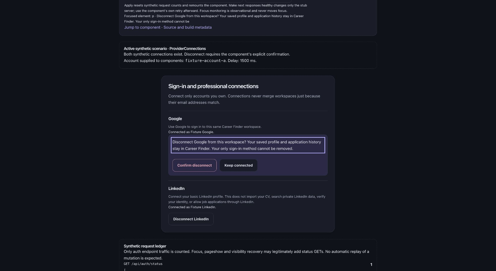

# Career Finder — account follow-through, competitor research and coordinated checkpoint

**Review date:** 17 November 2026.
**Product checkpoint:** e1dce0e24ef8d1fe85934578d1ba33bde99f166d.
**Branch:** continuation/feed-reliability-20261117-4b851.
**Scope:** authorized Career Finder continuation under saleh-app-workflow; Good Spender excluded.
**Clock:** original start 16 November 22:26:12 UTC; extended cutoff 18 November 22:26:12 UTC / 19 November 01:26:12 Riyadh. Active engineering hours are not completely recorded; elapsed time is not an effort claim.

## Outcome and remaining limits

The reviewed account follow-up is implemented, committed, pushed and independently remote-verified. The exact final source passes typecheck, full strict lint, the complete hosted test chain and the hosted build under Node v24.22.3. The dependency audit still fails. Actual Chrome checks established several account recovery and focus behaviors on recorded source hashes; the final inline focus refactor still needs its own English/Arabic narrow-screen browser retest after browser access returns.

The competitor review covers nine services and ten capability groups. It identifies real feature gaps and measurable opportunities to improve complete tasks. No universal superiority, 100% reliability, security certification or release readiness is established. Competitor documentation is not an executed comparative benchmark.

All seven requested streams were identified: two browser Build conversations, one browser Heavy research conversation, three actual Grok terminal sessions and this root chat. Current native changes overlap and require explicit owner reconciliation. A helper review agent is not an extra terminal. Publisher d57f4cd77813 retains native integration/builds/CI/signing/stores; development 5bc6158967e8 retains dependency remediation.

This report supersedes older mutable status in the predecessor evidence folder. The original logs, failed attempts and older source-specific results remain historical evidence.

## 1. Implemented account changes

Commit [e1dce0e](https://github.com/swonyu/ahmad-career/commit/e1dce0e24ef8d1fe85934578d1ba33bde99f166d) changes three files, with 43 insertions and 10 deletions.

| File | Result | Final SHA-256 |
| --- | --- | --- |
| hosted/app/components/ProviderConnections.tsx | Preserves focus before an explicitly activated action becomes disabled/removed; moves synchronously to the stable provider heading only if that trigger currently owns focus. No asynchronous focus stealing; existing eligibility, verified-state and duplicate-action guards remain. | 03c766b5bfe7b04f30ca545e78dac63225a1b371f8ae35d96a1a80dfaf6047c8 |
| hosted/app/components/SignInOptions.tsx | Removes redundant provider-availability uncertainty captions only for the already identified expired-session state. Provider availability failures retain their correct message and actionable retry. | fa9818300bdd6c0316befcd04c9fb53ec1aa02282f5acfdbeffb611ac0e731fc |
| hosted/tests/account-recovery-lifecycle.mjs | Adds production OAuth feedback tone and negative-path regressions, including wrong-method sign-in, unconfirmed connection, cancellation and failed return. | 60a2fd94573de75046060e1b7f9e2be600d9875094c21705340191f90351df9b |

The focus defect was reproduced: after a failed disconnect, disabling the activated confirmation button left focus on BODY, and the next native Tab reached Disconnect Google while skipping the earlier Check current connection recovery action. BODY focus by itself was not labelled a WCAG failure; the actionable navigation problem was the finding. The synchronous heading change corrected that observed route on the first candidate and preserved focus elsewhere when the user moved away during the request.

The first focus implementation failed the existing react-hooks/refs lint rule. An intermediate rewrite also failed. The final version performs the comparison and focus call directly in the explicit handlers, preserving the async mutation signature and all guards. No lint suppression, dependency change or assertion weakening was used.

The sign-in wording change is clarity work, not a newly proven authentication vulnerability. Prior copy said availability could not be confirmed; it did not assert a confirmed provider outage.

Grok Build1 supplied a useful additional test block. Its raw patch was malformed and did not apply even with recount. The original is retained. Root regenerated a valid full-context patch from the exact inserted block and two verified baseline replacements, then independently executed the resulting 17-test suite. The test harness exercises actual production handlers/effects using synthetic ports; it is not a DOM, browser cookie-jar, OAuth-provider or assistive-technology pass.

## 2. Verification at the final source

The pinned executable is recorded in the manifests under the owned evidence toolchain. Node **v24.22.3**, npm **11.20.0**. No new install or package/lock change was made.

| Gate | Final observed outcome | Evidence |
| --- | --- | --- |
| Typecheck | Exit 0 | final-account-browser-followthrough-20261117/retest-inline-focus/01-typecheck.log |
| Full strict lint | Exit 0, zero warnings | retest-inline-focus/02-strict-lint.log |
| Complete npm test chain | Exit 0 | retest-inline-focus/03-complete-test-chain.log |
| Hosted build | Exit 0; existing framework warnings retained | retest-inline-focus/04-hosted-build.log |
| Required full dependency audit | Exit 1; 19 high affected-package entries | initial 05-audit.log, referenced by final manifest |

The main Node group passed **289/289**, PDF checks **6/6**, and the targeted account lifecycle suite **17/17**. Account tests are part of a wider chain; do not add these scopes into an invented grand total. Other recorded chain scopes include 55 auth groups; 30 local-workerd auth requests, 12 using synthetic providers; 63 application groups; 47 discovery groups with 8 local-workerd requests and 97 client-schema responses; 19 phone groups with 164 local-workerd requests; and 34 vault groups. These units are not interchangeable.

The final snapshot covers 1,445 source paths. Its digest remained **060eda70b37c2125ecb708d8893adbf60eecda6f46976c3b3dc30894c1f4f96e** through the four gates. Final manifest SHA-256: **fb8ba58e97af3bc2756a7dad81d32b5081f2473255017c00d6d2a3b107589adc**. Initial five-gate manifest SHA-256: **40cb3ef76fb5909b0d550a5d24e6d81d2e08feec7fc39cc3886bed8a513da107**.

The audit was not needlessly repeated after only the final focus-handler rewrite. package.json, package-lock.json and node_modules/.package-lock.json were byte-identical to the explicit failed audit inputs; the final receipt preserves that fact. The existing npm audit configuration was not weakened or presented as an audit pass.

Three generated hosted verification receipts changed during the final test chain and are included in this evidence checkpoint. The separate worker receipt did not change. Existing build warnings concern future native config-loader/import behavior, RSC sourcemaps and limited route classification; they were not suppressed or labelled newly proven runtime defects.

A final independent read-only review checked the e1 commit, source hashes, manifest/log hashes and reporting limits. It found no new source integration blocker, confirmed the four exits and test counts, and specifically rejected treating final03c browser acceptance, audit or native corpus acceptance as passed.

## 3. Actual browser evidence and its boundaries

The preserved fixture imports actual production components/helpers/CSS with locked installed React and related dependencies, using synthetic loopback responses. Production guards, fetch, DOM, keyboard focus, history and navigation behavior were exercised. The only framework substitution is the documented next/image wrapper. It is neither the deployed app nor a native/provider test.

Saved raw observations: account-browser-final-20261117.jsonl, 49,955 bytes. The fixture README and source describe all controls and source binding.

Observed cases include:

- Explicit disconnect made exactly one POST with the expected synthetic account and connection. Keep connected made no disconnect POST and returned to its usable trigger.
- A successful disconnect POST did not produce false success when the subsequent status read still said connected.
- After a failed disconnect, Check current connection performed a status GET without replaying the mutation.
- Earlier focus candidate349 retained heading focus while busy and made Check current connection reachable next; moving focus elsewhere during the request did not cause a late focus jump.
- Connect exposed the correct busy text and one POST; the intentionally invalid local authorization URL was rejected without leaving loopback.
- SignInOptions at final fa981 showed expired-session recovery without redundant provider captions; ordinary503 retained its error, and a status retry restored healthy availability without mutation.
- LinkedIn configured only as a connection did not become a direct LinkedIn sign-in method.
- Real mounted SessionRecovery unmount aborted/ignored the pending operation and produced no late navigation.
- Real mounted A→B→A account-prop changes aborted the original request, preserved enabled recovery on return and made no automatic additional POST.
- An explicit recovery retry after503 made a second deliberate POST and followed the safe local return route.
- OAuth cancellation used status feedback without an auth request and stripped callback parameters. Unconfirmed connection used an alert and did not claim success.

A verified OAuth completion was also observed in tool output: no early success while the GET was pending, then status after successful verification, with stable outside focus. That specific completion was not appended to the JSONL before interruption. This narrative records the observation but does not fabricate a raw receipt.

Pending: the interrupted failed-OAuth browser case; final Provider03c English/Arabic narrow-screen focus checks; real provider/cookie-jar timing; physical VoiceOver/TalkBack; native account/search/application journeys on the newly integrated source. Existing synthetic and source tests remain useful without filling those gaps.

After a session/tool update, Browser reported that its originating extension context was unavailable. No alternate browser/CDP/HTTP route was used to bypass it. The three Grok tabs had been marked deliverable earlier. Only owned fixture PID36176 was stopped after verifying the exact server path; the cleanup receipt confirms it was absent afterward. Native/other-owner processes were left alone.

This screenshot is the actual earlier ca3 confirmation-focus observation, not the later busy-heading refactor, final Arabic review or physical accessibility acceptance. Its SHA-256 is 70a9026e94eff08fa7a785fea8dcc7e9f74139090b08a38b201454c00784cc3a.

## 4. Competitor coverage and measurable improvement

Read [competitor-capability-and-quality-review-20261117.md](competitor-capability-and-quality-review-20261117.md) for the complete competitor review, source register, nine-service matrix, ten capability rows, free alternatives and assigned acceptance targets. It reuses prior project research and updates primary documentation; it does not claim competitors were logged into or their reliability measured.

The comparison includes **Teal, Huntr, Simplify, Jobscan, LinkedIn, Indeed, Bayt, Naukrigulf and Saudi Jadarat**. Several contrary facts materially change the standard:

- Simplify documents iOS and Safari Copilot; application assistance is not desktop-only.
- Jobscan advertises approval before every submission. A confirmation button alone is not a unique advantage. The final source check also found its credit-based pricing FAQ; the competitor matrix now records the paid boundary and conflicting no-subscription tagline without assuming universal free access.
- Teal documents per-application resumes and export, plus optional Gmail/calendar/Drive capabilities in its current policy.
- Naukrigulf's Arabic Android listing advertises CV and interview tools; Bayt and Naukrigulf already support bilingual/native use.
- Jadarat is useful to eligible Saudi citizens; it is not a universal worldwide substitute.
- Career Finder already implements hosted CSV/ICS, saved-note search and native JSON transfer. These should be completed and verified, not repeatedly proposed as absent.

Career Finder does not establish equivalent breadth in profile-aware ranking, regional inventory, mobile autofill, editable multi-document application packets, professional networks/inbox-derived updates or interview coaching. A direct employer-page route is a valid working alternative when automation is unavailable, but not equivalent automation coverage.

The immediate target is reliable completion of matched tasks:

| Improvement | Acceptance target — still a target unless separately executed | Existing owner |
| --- | --- | --- |
| Truthful discovery and fallbacks | Distinguish empty, incomplete, unavailable, stale and restored results; retain context and useful employer-page/filter/retry options in both languages. | Native search; root hosted |
| Account/application recovery | Preserve job, profile and selected document on external return; no automatic mutation replay or false receipt after an uncertain outcome. | Recovery; root; publisher |
| Portability | Actual Save/Share and reopen/import, correct Unicode/date values, no lost drafts/notes/history or imported authorization; calendar verified in a real consumer. | Recovery; root; publisher |
| Bilingual accessibility | Complete account → search → save → return → recovery with keyboard, large text and physical readers; no late focus theft. | Accessibility with search/recovery; publisher |
| Useful evidence and fit | Explain source, checked time and matching basis; keep unknown eligibility and dated research explicit. | Search/product |

These targets must be measured against current competing tasks before saying Career Finder is better. Larger additions remain visible gaps for a separate bounded design, with costs, data flows, sources and output quality assessed.

The existing Heavy conversation received this broader request and a strict correction request after its first competitor response used unsupported stronger/parity labels and omitted newer capabilities. Root's independent report corrects those claims. The newest Heavy reply is unread because Browser is unavailable; it is not counted as reviewed.

## 5. Dependency blocker: actual partial alternative, not a waiver

Read [picomatch-remedy-independent-review-20261117.md](picomatch-remedy-independent-review-20261117.md) and the candidate experiment README/results.

At the checked time, GitHub's reviewed GHSA-fc5q-39xc-vjpf entry classified versions through4.0.7 as affected and listed no patched version. Snyk had revoked its related entry and described a maintainer dispute. Those sources disagree; neither constitutes a clean project audit. Production reachability, algorithmic behavior and scanner policy are separate questions.

Installed resolutions were micromatch4.0.8 → picomatch2.3.2; tinyglobby0.2.17 → nested4.0.4; vite8.3.8 → nested4.0.7. Their dev flags and negative literal-name searches in built files do not prove runtime non-reachability.

A bounded, independently supervised experiment used only disposable copies:

- 288 short semantic/capture comparisons per version matched baseline, plus seven explicit valid cases.
- Three baseline stress cases exceeded the external750ms deadline.
- Twelve covered candidate probes completed with the expected false result and exit0, about28–40ms process time.
- The candidate2.3.2 capture:true case still exceeded750ms.
- Four owned timed-out processes were terminated and waited for; total execution was3.635seconds, with a21second allocated bound.
- The29 installed files and lock remained unchanged. No install, repository dependency edit, native build, CI dispatch or audit exception occurred.

This is a **partial candidate**, not a production fix or security/audit pass. Preserving capture semantics leaves a residual performance case. Development5bc owns the actual remedy and any package/lock/policy decision; findings were routed in PR comment6959058434. Raw candidate code retains applicable upstream licenses. Do not apply these patches blindly.

## 6. Grok Build2 corpus: recovered, corrected and reviewable

The three inline deliverables were extracted, hashed and statically reviewed. The generator uses only hashlib/json/pathlib and bounded fixed writes; the sole adaptation adds a generated output directory. Its earlier execution exited0. All10 generated file byte lengths/SHA-256 values match the manifest, which is byte-identical. Nine fixtures parse; fixture07 is deliberately malformed. Ten immutable source copies match saved receipts.

This establishes corpus integrity, not native decoder/device acceptance. No ZIP was retrieved; no ZIP link or checksum verification is invented.

Use [grok-backup-corpus-reviewed-20261117/README.md](grok-backup-corpus-reviewed-20261117/README.md) as the corrected interpretation:

1. iPhone already deduplicates saved-link identities during import.
2. Fixture04 has no application records/drafts and cannot demonstrate note loss.
3. iPhone Stop holds restore only into a matching, non-local destination workspace.
4. A baseline duplicate-draft omission does not establish the recovery owner's newer result.
5. Record destination snapshots, explicit profile replacement, restart and re-export; an unchanged source file is not successful recovery.
6. The unavailable8bfd3136 comparison remains unverified.
7. Proposed09 is a server view, not a phone backup.

The corpus belongs with the existing recovery lane. Source packages/images were not resent.

## 7. Current ownership and integration evidence

[current-owner-snapshot-20261117.json](current-owner-snapshot-20261117.json) records20:11–20:14UTC observations. The older seven-workstreams-native-overlap report remains historical and is superseded where the snapshot advances a head or dirty set.

| Stream | Current observed identity/source |
| --- | --- |
| Build1 | https://grok.com/c/adc8cfe9-ed35-4fcd-9961-d1fc081daef0 — Build verified; actual account test contribution reviewed; new CSV/ICS evidence task reply pending read. |
| Build2 | https://grok.com/c/abe34c88-8973-4ecb-aacc-9a7e595c33ef — Build verified; corpus delivered and independently corrected. |
| Heavy | https://grok.com/c/3bf518a8-10be-40cd-9d0e-7a811c512a74 — Heavy verified; blocker and competitor reports read/challenged; latest correction reply pending read. |
| Terminal search | 01a1ea9d-107f-7f91-bb26-90cb6f496046, PID61499, 11cb-based,10dirty paths; sole shared native localization writer. |
| Terminal recovery | 01a1ea9c-fd25-75a3-b146-e39e344cc262, PID61036, 11cb-based,8dirty paths. |
| Terminal accessibility | 01a1ea56-c4d3-7252-9cae-7595ad0e9957, PID17201,87d7238,18local commits plus dirty NativeCareerViews.swift. |
| Root | 4b851318da2d, hosted checkpoint e1dce0e and this evidence follow-up. |

Accessibility's20 changed paths overlap all10 search dirty paths and recovery MainActivity.kt, MobileApplicationState.swift and NativeApplicationsViews.swift. Do not blindly cherry-pick or overwrite the live trees. Its last notice addresses obsolete01a49; current publisher/owner acknowledgement is still required. A process being present proves existence at that observation, not uninterrupted progress.

Publisher3a08819d is the merge of243031d and earlier root4221871. Its native/localization/workflow/package trees are identical to root e1, and PhoneApp.tsx has the same SHA-256 cea98d8442f0dcb43cee2b1e3d5d5a2814a89130b7c18793ee50f4a8366d5368. It does not include the18 local accessibility commits.

The exact3a-versus-e1 comparison found47 differences:37root-only evidence paths, two handoffs, three e1 follow-up files, four generated receipts, and one differing localization fixture. Publisher's fixture independently binds the real addEmployerBoard initializer through executable setup. Root's earlier997 fixture uses an intentional non-executing stub. Do not overwrite the publisher's working source correction or claim its old unbound ReferenceErrors remain; reconcile the test approaches intentionally and run the combined gates.

At20:18UTC, independent review confirmed another source-level CI risk at publisher3a: .github/workflows/phone-quality.yml uses a concurrency group containing workflow and ref, with cancel-in-progress:true, but omits acceptance_scope. Full, iphone-ui and iphone-connection manual runs on the same ref can cancel each other. No specific cancellation incident is inferred. Publisher should normalize the scope into the key, using the existing workflow expression, and verify it during coordinated CI. Ordinary pushes to the recovery/publishing branch do not match this workflow's push filters; no automatic run is assumed.

The native lock was absent at20:11UTC and no matching xcodebuild/gradle process names were observed at20:12. This momentary absence does not transfer build ownership. No native build was started by root.

## 8. CI, deployment and release status

Latest observed run41 / [44147056599](https://github.com/swonyu/ahmad-career/actions/runs/44147056599) at243031d completed the iPhone-only scope:17/17, zero failures,1283.028seconds, normal TEST SUCCEEDED and evidence export. Four other jobs were skipped. This supersedes the old16/17 narrative for that exact later source; it does not validate3a/e1 plus pending native work.

Run40 at63e was historically Android104 ordinary plus one TLS and one HTTPS pass, iPhone15/17, hosted audit failure. Run38 at21f had a historical five-job pass. Keep dates/source/scope attached; an older green run cannot override a new audit failure or validate unintegrated changes.

No current combined five-job/native/physical-device pass, signed store build, upload, submission, approval or release was established in this cycle. Earlier reports describe support pages live and App Store1.1 in Prepare for Submission; those are historical reported states, not a newly executed store check. Real Google account journeys, LinkedIn configuration, physical accessibility and actual download/calendar/native transfer consumers remain separate gates.

## 9. Continuing safely

The two updated terminal handoffs are under docs/continuation-handoffs/2026-11-17-native-search.md and 2026-11-17-native-recovery.md. They include the full core contract, exact seven-lane identities, overlapping files, competitor targets, corpus corrections and original cutoff. Continue the registered sessions; do not launch duplicates.

Next owner actions are concrete:

1. Publisher and native owners acknowledge/reconcile the18-commit accessibility overlap, preserve root's three e1 changes, review the alternative localization fixture and correct the workflow scope key.
2. Dependency owner resolves the actual audit/algorithm/production-exposure decision with tested evidence; the partial copy experiment is a candidate only.
3. Recovery owner executes the corrected corpus against current owned native source; publisher schedules combined iPhone/Android and physical accessibility gates.
4. On restored originating Browser access, review the two outstanding Grok replies and finish final03c EN/AR and interrupted OAuth/real-consumer checks, with exact hashes and actual outcomes.
5. Preserve the original hourly continuation and cutoff, report only real changes, and stop at completion/cutoff without claiming uninterrupted work.

The evidence checkpoint containing this report is documentation, reproducibility material and generated receipts. It does not introduce an additional product/native/dependency change. A post-checkpoint remote receipt and owner coordination message identify its exact commit.
