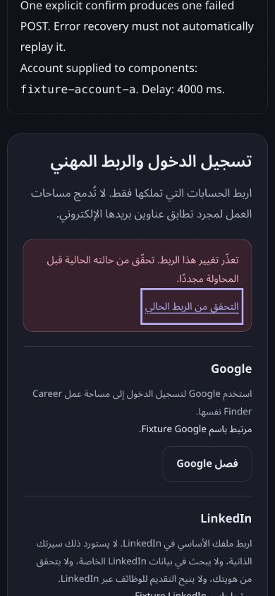

# Career Finder — implemented cleanup and verified export consumers

**Checkpoint date:** 18 November 2026, Riyadh. This report records completed work and explicit remaining gates. Refresh owner messages and CI before acting on a time-sensitive state.

## Outcome

Product checkpoint **da68bbfbdcc6429d72d1faa28b5809a554142c57** is committed, pushed and remote-verified on **continuation/feed-reliability-20261117-4b851**. It adds defensive cleanup for temporary browser-download resources when a DOM operation throws synchronously. The change is based on the integrated parent **2884188263f3dad5753da7b2e507f6ba55e30eb0** and changes only PhoneApp's download helper and its focused test file.

The exact updated source passed typecheck, strict lint, the complete hosted test chain and build under the project's pinned **Node v24.22.3 / npm 11.20.0**. The full dependency audit still fails with **19 high affected-package entries**. This is not a release-ready checkpoint.

Separately, actual English and Arabic account recovery interactions passed in the browser on parent 288. Actual app-generated CSV downloads from that parent were imported into installed LibreOffice with every cell preserved using the documented text-import route. Three actual calendar downloads passed byte/content checks. The newer download helper's browser rerun, actual Calendar import and native device handoff remain pending.

## 1. Product change and strict critique

The previous helper allocated an object URL, appended a temporary anchor, clicked it, removed it and scheduled URL revocation. An exception after allocation could skip removal and revocation. This is a source-confirmed cleanup hole reproduced through **injected synchronous failures**; it is not a demonstrated ordinary customer download outage.

The new helper creates the detached anchor before allocating the URL. Its outer finally removes the anchor; a nested finally releases the object URL even if removal itself throws. A click that returns normally keeps the existing 30-second URL lifetime so the browser has time to consume it. A failure before that return revokes the URL immediately. The helper preserves the same serialized bytes, MIME, fixed filename, synchronous activation and exception propagation.

The name clickReturned deliberately describes control flow. It does not assert that the browser saved the file. No automatic retry, duplicate click, application-state mutation or new download-success claim was introduced.

An independent source reviewer inspected the exact final PhoneApp and test hashes and found no material issue. That reviewer did not execute the gates. Its source-only review narrative is preserved in [download-cleanup-independent-review.md](resume/download-cleanup-independent-review.md).

### Tests and meaningful before/after evidence

Eight new checks execute the actual AST-extracted production helper and actual CSV/calendar handlers. They cover normal byte content including the UTF-8 BOM, allocation and element-creation failures, append failure, injected click failure, removal failure, unchanged record state after failure, withheld success notices and explicit retry.

The corrected parent-source comparison produced **33 passing / 6 failing checks out of 39**. The final targeted suite passed **39/39**. Two test-harness corrections are preserved honestly: Blob.text() strips the BOM during decoding, so byte comparison uses arrayBuffer(); and the optional notice error property may be absent rather than explicitly false. Neither was a product defect. The final test-file hash differs from the earlier red-run hash because of the optional-property assertion correction. The logs are not represented as identical-test-byte red/green executions.

In the deliberately failing removal stub, the result proves eventual URL release; it cannot prove that the failed removal detached the anchor.

### Completed gates on the updated source

| Gate | Command or scope | Actual result |
| --- | --- | --- |
| Runtime | Pinned Node / npm | v24.22.3 / 11.20.0 |
| Typecheck | npm run typecheck | Exit 0 |
| Strict lint | npm run lint -- --max-warnings=0 | Exit 0 |
| Full hosted tests | npm test | Exit 0 |
| Main Node group | Included in full test chain | **297/297 passed** |
| PDF group | Separate group in the chain | **6/6 passed** |
| Focused record tools | Actual production extraction | **39/39 passed** |
| Hosted build | npm run build | Exit 0 |
| Full dependency audit | npm audit --audit-level=high --json | **Exit 1: 19 high, 0 critical** |

The 39 focused tests are included in the broader verification; do not add overlapping counts. Existing native-loader/RSC/source-map build warnings remain visible in the logs and were not suppressed. Source, test, package and lock hashes remained unchanged while these gates ran.

The complete test chain also produced these narrower synthetic service receipts:

- Applications: 63 checks against actual Miniflare D1/R2, 12 synthetic provider POSTs, zero real employer submissions.
- Phone: 19 groups, 164 actual workerd requests, 2 synthetic POSTs and 10 synthetic GETs, zero real employer submissions.
- Discovery: 47 groups, 8 actual workerd requests and 97 client-schema responses, zero public provider requests or applications.

These are meaningful local service regressions, not production HTTPS, live OAuth or native acceptance. The three generated verification receipts are retained in hosted/tests rather than discarded.

See [full gate receipt](resume/download-cleanup-full-gates.json), [test log](resume/download-cleanup-full-test.log), [audit log](resume/download-cleanup-full-audit.log) and [push receipt](resume/download-cleanup-product-commit.json).

## 2. Account recovery: actual English and Arabic browser evidence

The synthetic fixture was rebuilt from parent 288 and the exact final account component hashes. These components are unchanged by da68.

In both languages, the browser exercises verified that Disconnect focuses its confirmation paragraph; confirming moves focus to a stable heading while the POST is pending; a 503 retains the known connection status and shows recovery feedback; actual keyboard Tab reaches Check current connection; and actual Enter retries with **GET only**, without replaying the disconnect POST. Successful readback restores known connections.

The Arabic narrow-screen exercise moved focus with real Shift+Tab to the fixture’s ‘Source and build metadata’ link outside the connection component while the POST was pending. The later failure left focus there, avoiding asynchronous focus theft. Keyboard Tab could re-enter the retry control. The measured Arabic viewport was 390×844 CSS pixels, with no horizontal overflow in that observation.

Selected failed-OAuth feedback used constant app copy, exposed one alert and did not initiate auth requests. An untrusted error-description query value was not displayed. The query parameter remained in the URL; this is not a claim that all URL parameters were removed.

[Raw browser acceptance record](resume/account-browser-acceptance-20261118.jsonl) and [fixture metadata](browser-fixtures/account-build-metadata.json) identify the source and observations.

This does not establish live OAuth/cookie behavior, a real account mutation, physical VoiceOver/TalkBack acceptance or native account acceptance.

## 3. Actual downloads and spreadsheet interoperability

### App UI to downloaded CSV to installed consumer

The actual PhoneApp fixture used parent 288 source and synthetic guest data. Its Next Image adaptation and source hashes are recorded; account/employer mutations were blocked. The record was created through the visible UI, including an Arabic/English title, quotes and comma, emoji, a multiline private note beginning with a formula-like string, and a follow-up date.

The exact downloaded English and Arabic CSVs were then imported by the existing **LibreOffice 26.8.1.1** installation using the documented quoted-fields-as-text recipe.

| Download | Bytes | SHA-256 | Consumer result |
| --- | ---: | --- | --- |
| English (1) | 489 | 6337ab97ad63ddf64bcf6e4cf55a5b176ef1abe99890426f638ff3c17ff44e64 | **18/18 cells exact; 0 formula cells** |
| Repeated English (2) | 489 | Same as English (1) | Hash equality verified; not reconverted |
| Arabic (3) | 670 | f920db19636bbee85ceb9dfffd4a0045bf8946364f95f8a3a10605786c6542d8 | **18/18 cells exact; 0 formula cells** |

Each imported document contained 17 string cells and one intentionally blank optional applied-date cell. The bilingual text, translated headers/stage, follow-up date 2026-11-24, full multiline protected note and edit timestamp matched exactly. **No normalization was needed** for these two files. Original downloads were hash-checked before and after conversion and remain unchanged.

The consumer check was one bounded invocation for the two files after checking that an interrupted attempt had left no process or output. It was a headless import into the actual installed application, not a simulated CSV parser; spreadsheet GUI appearance and other consumers remain separate.

See [consumer report](resume/browser-downloads/consumer-en-ar-20261117/README.md), [exact cell/type receipt](resume/browser-downloads/consumer-en-ar-20261117/ui-download-consumer-receipt.json) and [invocation](resume/browser-downloads/consumer-en-ar-20261117/receipts/invocation.json).

### Date-input observation and evidence limitation

An initial browser-control fill made the native date input look valid in the DOM, but save/reopen showed no persisted date. Actual native arrow-key edits followed by save/reopen did persist the intended date. Source inspection found no clearing conversion in the change→draft→save path. This is retained as an automation event-delivery caveat, not a validated app data-loss defect. The earlier blank-date CSV is preserved as an honest intermediate observation.

The raw export-browser buffers were lost when the originating browser context was interrupted. [export-browser-observations-20261118.json](resume/export-browser-observations-20261118.json) is explicitly a normalized record, not a raw transcript. Actual downloaded bytes, fixture metadata, hashes and independent consumer outputs are retained. The account raw record was saved successfully.

### Broader synthetic corpus

A separate production-helper corpus exercised 17 records per language, including longer notes, control-like text, Arabic, punctuation, dates and calendar boundaries.

- Quoted-fields-as-text import preserved **162/162 cells per language**, with 149 strings, 13 blanks and zero formula cells.
- Saving/reopening ODS and saving/reimporting CSV retained those values. Only CRLF/CR-to-LF paragraph normalization was permitted in that broader comparison.
- Default and formula-enabled imports changed six displayed values and coerced seven free-text cell types per language. The existing app disclosure about spreadsheet interpretation remains relevant.
- A positive-control arithmetic formula evaluated to 2, confirming that the test could detect active formula evaluation.
- Twenty production-generated ICS files passed the corpus's byte/content checks.

This supports the documented text-import workflow. It does not establish that default spreadsheet opening always preserves identifiers and dates. The official [LibreOffice CSV filter documentation](https://help.libreoffice.org/latest/en-US/text/shared/guide/csv_params.html) explains the import options.

The [79-file portable evidence archive](export-consumer-corpus/portable-export-consumer-evidence.tar.gz) was checked against its saved member hashes before copying. [HANDOFF.md](export-consumer-corpus/HANDOFF.md), [verification.json](export-consumer-corpus/verification.json) and the two later review addenda remain readable alongside it. Its earlier source/runtime narrative is timestamped evidence; newer actual-download results are above.

## 4. Calendar export: what was and was not exercised

Three files were downloaded through the actual app UI: Arabic and English versions for 2026-11-24, and a later English export after changing the record to 2026-11-25 through native keyboard input.

The Arabic/English pair has the same all-day DATE and UID. The changed-date export has the changed DATE and a new UID. Each has one event, P1D duration, PRIVATE class and TRANSPARENT availability; UTF-8, CRLF and 75-octet folding checks passed. Private notes and formula-like note content are absent, as are attendee, organizer, attachment and alarm fields.

The UI explains that changing the record later does not update an already imported calendar entry and that notifications are managed in the calendar application. The byte checks use the production output and the [RFC 5545 format](https://www.rfc-editor.org/rfc/rfc5545); **no Calendar import or reimport was run**. Consumer-specific duplicate/replacement behavior must be tested before making a promise about it.

See [ICS receipt](resume/browser-downloads/ics-download-verification.json) and the three adjacent downloaded .ics files. iPhone/Android share-sheet or installed-calendar acceptance remains pending.

## 5. Dependency blocker and working alternatives

The current root lock still produces 19 high affected-package entries. These are not 19 demonstrated distinct exploits, and source reachability has not been established by the audit count. Conflicting advisory treatment and an open upstream patch do not constitute a released, project-validated fix.

The publisher's existing **Career-ToolchainProof288** proposal was reviewed without editing it or starting a competing migration. Its package/lock diff genuinely removes the three Picomatch resolutions and several framework/build dependencies. It is not merely a renamed fork or audit suppression. However, unchanged project contracts still require removed packages:

- install scripts reference vinext;
- build/runtime code still uses Vite/vinext and the current worker fetch handler;
- source and type imports still depend on Next;
- lint references Next configuration;
- PDF fixture tooling still expects Vite;
- the start contract expects the previous server output.

No current successful install, audit, build or full-test receipt for that proposed graph was found in the bounded owner evidence locations. Its node_modules was absent at inspection. The changed lock is therefore an **unfinished dependency-graph removal proof**, not a working migration. The preceding integrated CI and the newer iPhone-only rerun cannot validate it.

A viable remedy must include the actual replacement build/runtime/lint contracts, preserve account and worker semantics, and pass the pinned-runtime full regressions and unchanged audit gate on the new graph. Alternatively, an upstream/fork correction requires a bounded adversarial corpus covering mixed extglob branches, slash behavior and capture options, plus compatible project integration. Neither route is complete here. We did not install packages, run a second migration or weaken the audit policy.

Production dependency remediation remains with **5bc6158967e8**; publisher **d57f4cd77813** retains its existing proof checkout and native/build coordination. See [current dependency review](dependency-review/README.md) and [publisher proposal critique](dependency-review/PUBLISHER-TOOLCHAIN-PROOF-REVIEW.md).

## 6. Native source and CI

The integrated parent 288 already contains root's earlier e1 account follow-up, native-search checkpoint **0beff68a6906968f282dca292dc547daad85684f** and the prior feed cleanup lineage. Do not repeat the older claim that those changes still await integration, and do not reapply the isolated original feed patch.

[Integrated run 44185640786](https://github.com/swonyu/ahmad-career/actions/runs/44185640786) at 288 finished with failures in the hosted audit and one iPhone UI assertion. Its Android native acceptance completed **112 ordinary + 1 TLS + 1 native HTTPS checks**; iPhone logic and unsigned build passed. The final iPhone UI result was **16/17**, from a normally finalized 1,083.171-second run.

That UI failure expected the old generic empty-search wording. The native search change intentionally supplies the more precise complete-empty title and detail. Publisher checkpoint **a17999ce9f24d1e8c94a38c03dcda68101db4507** updates that assertion against the actual complete-empty accessibility label. It is already pushed and owned by the publisher. Root and Grok reviewed applicability without duplicating its native fix.

The final **23:47:29 UTC** read confirmed [iPhone-only run 44194197445](https://github.com/swonyu/ahmad-career/actions/runs/44194197445) at a179 completed **successfully at 23:27:52 UTC**. Its raw log contains **17 distinct named cases passed, 17 executed, zero failures**, in **1,478.798 seconds**, including the previously failing empty-search journey. The finalized xcresult was exported with 36 attachments and artifact **14378904630** was uploaded. The 191 MB artifact was not downloaded or visually reviewed by root/helpers. Four other jobs were skipped, as was the partial-verification step; the actual named-case and suite-total log establishes the count. This is iPhone **simulator UI** acceptance at a179, not a physical-device pass, a new full five-job run or acceptance of the later root/accessibility/recovery changes. See [exact run result](native-integration/run44-result-summary.json).

The search terminal is clean at 0be and its checkpoint is integrated. Recovery remains at 11cb3d4d8c15e9b16719b6e7091597f43633cda6 with seven modified source files plus new NativeRecoveryCheck.swift; all eight dirty hashes remained stable during the map. The frozen accessibility review covers **27 commits through 00e4257e519dec88b2b532ef606fbe0633966314 across 20 paths**. Its later clean head **2230499e48104c7380d150e010d1859ff42b0c6a**, a one-file private-backup-source localization change, is preserved and inspected separately, bringing the observed series to 28 commits.

The [integration map](native-integration/INTEGRATION-MAP.md) separates 11 small review units. Eight paths were unchanged between the publisher base and 288; three also contain recovery work with different or adjacent changed lines. The newer search implementation is stronger than parts of the old accessibility branch: preserve captured-query retry, canonical boards, source freshness and partial/unavailable states. Add distinct announcements, saved-search recovery and long-input retention deliberately. In Android board input, retain the existing field error styling/association while adding spoken feedback. Merge the one new email-correction translation through the search/localization owner and regenerate; do not overwrite generated resources. No patch was applied or compiled by this review, and file/hunk comparisons are not a guaranteed cherry-pick result.

Publisher d57 retains all native integration, build/CI scheduling, signing and store ownership. No new native build or CI dispatch was started by root. The shared workflow concurrency key remains an owner issue to reconcile; do not infer an actual cancellation without a run event.

## 7. Grok coordination and competitor conclusions

The three existing browser sessions were observed as **Build / Build / Heavy**, and all three latest replies were read before browser control lost its originating context again:

| Session | Latest completed work | Review outcome |
| --- | --- | --- |
| [Build 1](https://grok.com/c/adc8cfe9-ed35-4fcd-9961-d1fc081daef0) | Export retry/cleanup source critique and inline test proposal | Root independently reproduced and fixed the cleanup gap; Grok's unsaved runner is not counted as root execution. |
| [Build 2](https://grok.com/c/abe34c88-8973-4ecb-aacc-9a7e595c33ef) | Employer-return source critique and native assertion review | No new material hosted defect demonstrated; actual installed-phone return remains untested. |
| [Heavy](https://grok.com/c/3bf518a8-10be-40cd-9d0e-7a811c512a74) | Dependency and competitor corrections | Several proposed improvements were already implemented/assigned; a duplicate notes proposal was rejected after source inspection. |

Earlier source packages and 39 images were not resent. The first two rounds have saved replies; the third is preserved as [normalized notes with explicit limits](resume/grok-third-review-normalized-notes.md). Browser-control loss is recorded in its exact error artifact. It prevented a new-helper browser retest and sending Heavy the final notes correction. It does not justify claiming that Grok continued to work afterward.

### Competitors: improve complete journeys, measure real gaps

The earlier nine-competitor matrix remains the baseline in docs/continuation-evidence/2026-11-17-account-competitors-4b851 and Career-Finder-Competitor-Review.md. This follow-through adds a source-checked correction: Career Finder already has searchable private record notes, with room for contact/follow-up context. Adding another free-text field would not deliver a new contact-management capability.

Official [Huntr contact documentation](https://help.huntr.co/en/articles/10089169-contacts-and-documents) describes structured contact details and job linking. Official [Teal tracker documentation](https://www.tealhq.com/tools/job-tracker) describes contacts and companies connected to the job-search workflow. Those are meaningful capabilities to compare against. Existing Career Finder notes are not proof of that same structured relationship model.

The immediate quality targets remain measurable:

- search distinguishes complete-empty, partial, unavailable and restored/stale states and preserves newer filter drafts;
- external employer return retains the selected job, profile and document without falsely marking an application as sent;
- uncertain submissions and account failures offer explicit readback/recovery without replay;
- backup/import preserves distinct notes, drafts and profile choices across clients;
- CSV and calendar export work in actual intended consumers;
- English/Arabic, RTL, keyboard, large-text and assistive-technology journeys complete successfully.

This checkpoint closes parts of account recovery and CSV-consumer evidence, and adds tested download cleanup. It does not establish universal superiority, broader job coverage, autofill parity, structured networking, interview coaching or inbox integration. No new paid feature or large unreviewed product expansion was introduced.

## 8. Continuation ownership, remaining gates and store status

The seven requested streams remain the two Grok Build browser conversations, one Grok Heavy conversation, the three existing Grok terminals, and this root coordinator. Independent helpers are reviewers, not additional terminal sessions.

The two handoffs in docs/continuation-handoffs are updated alongside this evidence. Continue the existing session identities; do not spawn replacements or overwrite their dirty work. Search owns central native localization. Recovery owns receipt/backup/profile-state implementation. Accessibility needs explicit integration agreement for its overlapping series. A posted root comment is not owner acknowledgement.

Remaining evidence gates:

1. Preserve the verified a179 17/17 iPhone simulator result and arrange subsequent acceptance of newly integrated source through the publisher.
2. Reconcile native search/recovery/accessibility changes by exact commit and hunk before integrated native acceptance.
3. Complete a working, audited dependency remedy on its owner's branch; the package-removal proof alone is insufficient.
4. Reconnect the authorized browser context, rerun the new download helper through the actual app and send Heavy the existing-notes correction.
5. Exercise actual calendar import/reimport and native file/calendar handoff.
6. Exercise current integrated iPhone/Android account, search, application return and recovery journeys in English/Arabic, including appropriate accessibility and large-text checks.
7. Establish any signed/uploaded/submitted/released store state with actual store evidence.

The two verified root-owned synthetic listeners were stopped after checking their exact commands. Fixtures and evidence remain preserved. No other owner's process was stopped.

No new signed upload, submission or release was established. Historical live support pages and draft store status do not prove current release readiness. Report implementation, tests, push, build, signing, installation, deployment, upload, submission and release separately.

Original clock: **16 November 2026 22:26:12 UTC**. Existing extended cutoff: **18 November 2026 22:26:12 UTC / 19 November 01:26:12 Riyadh**. No new clock was started and no remaining active-effort balance is asserted. Good Spender remains excluded.

## 9. Source identities and evidence index

| Source | SHA-256 |
| --- | --- |
| New PhoneApp.tsx | 5b1f3db0063b062f21209870274b83a3def83cb6bb056c987fd7dac0653e6352 |
| New phone-record-tools.mjs | 15ef941aae32725a097e4a88d8d245eb5611738cd41c216eddbd65118c0319a6 |
| Parent PhoneApp used in browser | cea98d8442f0dcb43cee2b1e3d5d5a2814a89130b7c18793ee50f4a8366d5368 |
| Unchanged record-tools.ts | 910dae464cd8504ed225fe5f68fa6b0750c7b7a9c7b18c6454ff4504a772e9a9 |
| Unchanged model.ts | 955d5afcede6b8f7eb901394f9ae3e00d1bbffa57bf1e457c5436f23541577bf |
| Unchanged ProviderConnections | 03c766b5bfe7b04f30ca545e78dac63225a1b371f8ae35d96a1a80dfaf6047c8 |
| Unchanged SignInOptions | fa9818300bdd6c0316befcd04c9fb53ec1aa02282f5acfdbeffb611ac0e731fc |
| Unchanged hosted package-lock | 2512e3bd6aebfc4377bbe036d3cf606c27e33613b35c8c58d28f0f3a0d596c99 |

- resume/: actual gate logs, failed attempts, browser evidence, coordination receipts and independent review.
- browser-fixtures/: parent-source account and export build metadata.
- export-consumer-corpus/: verified portable corpus archive, receipt and follow-up critiques.
- dependency-review/: exact graph/remedy research and publisher-proof critique.
- native-state/: earlier frozen owner/CI/source observations and native run logs.
- native-integration/: 27-commit map, separately preserved 28th commit, actual 17/17 run44 result, and a hash-verified archive of the complete frozen inputs.
- copy-receipt.json: original evidence paths, bytes and hashes. A final manifest records the completed checkpoint contents.

All evidence is scoped to its actual source and execution. Failed attempts and pending gates are preserved.
