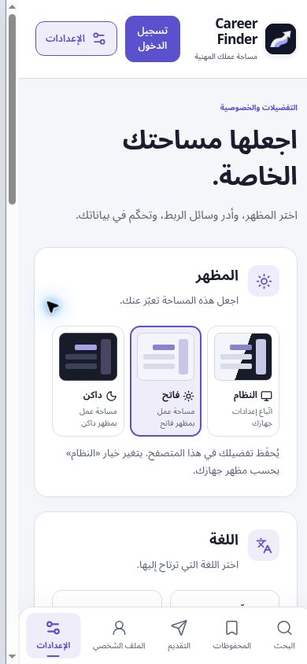
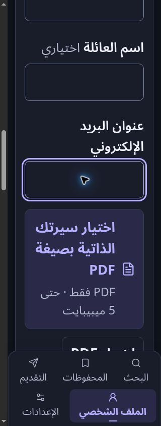

# Bilingual rendered review — 17 November 2026

This review used the actual React phone app and CSS inside an explicitly synthetic browser fixture. It did not access the existing guest vault or a real account. HTTP, storage names, preference keys and the language cookie were isolated at build time. External requests and online mutations were blocked. The receipt and source manifests identify exactly what was observed.

## Verified outcomes

The actual Language setting switched between English/LTR and Arabic/RTL. An unsaved profile retained its bilingual name, target-role lines, existing synthetic PDF and dirty-state notice during an Arabic → English → Arabic round trip. An open application-record editor also retained its bilingual note, newline and canonical `interview` stage; only the displayed label changed. A subsequent explicit local save used synthetic data and produced a manual application marker, not an employer receipt.

An initial account-check failure hid the account identity and private account/data tools in both languages. The fixture's first-visible-email observer remained empty. Appearance, language and help stayed available.

At 320 CSS pixels with the root text size set to 200%, the original fixed navigation columns split Arabic words into fragments. The mobile-only CSS fix lets whole navigation buttons wrap into rows and preserves each label. The five Arabic labels now form two rows. The existing navigation observer correctly updates both content padding and viewport scroll padding.

| Measurement | Before | Retained fix |
| --- | ---: | ---: |
| Arabic navigation height at 320px / 200% | 167.1875px | 148.59375px |
| Root measured navigation inset | — | 148.59375px |
| Root scroll padding at 200% text | — | 180.594px |
| Settled focused Email field bottom, dark Arabic | — | 392.734375px |
| Navigation top, dark Arabic | — | 695.40625px |
| Document / client width | — | 305px / 305px |

The focused Email field was completely visible above the navigation and retained a 3px focus outline. The Latin email control kept `dir=ltr` within the RTL page. This is a specific observed keyboard pass, not a complete WCAG certification.

The sign-in dialog remained open across an Arabic-to-English change. At 320px / 200% text, both versions measured 296px wide with equal 279px client and scroll widths. Content remained vertically scrollable, and closing the dialog returned focus to its original sign-in button. Provider options retained their honest unavailable/setup states in the synthetic configuration.

At 390px / 100% text, Arabic/light Settings retained five whole navigation labels in one row. English at 320px / 200% retained all five labels in a readable four-plus-one arrangement. A later optional spacing experiment was reverted because its browser check was blocked; the source retained here is the version already rendered successfully.

## Screenshots

### Arabic/light Settings at 390px

### Whole Arabic navigation labels at 320px / 200% text

### Dark Arabic keyboard focus at 320px / 200% text

## Source and validation

- Retained `phone.css` SHA256: `89d8c325e8009fd9842817b0d580db5386f834447f11023e84f7909070c3bbf8`.
- JavaScript fixture bundle SHA256: `cd4cfde2142612ce7cee4b90227eea5ff08db522f6fa616f01662cb6214fcde4`.
- Source hashes and isolation names: `final-source-manifest.json`.
- Full bounded observations, artifact hashes and limitations: `receipt.json`.
- The CSS build completed and the whitespace check passed.
- Four portable localization regression groups passed separately: actual React review rendering; recovery count formatting; actual clipboard handler with a synthetic clipboard; and the exact discovery-notice composition. These tests do not run external services.

## Limits and blockers

The browser URL policy rejected an iframe observation immediately after a reload, stating that the protocol/authority to observe was not allowed. No workaround, indirect execution, alternative browser surface or subsequent page inspection was attempted. The source and static fixture were restored to the already rendered CSS version. The live tab might retain the subsequently reverted spacing experiment until a legitimate reload; its pixels were not rechecked after the rejection.

The final desktop RTL revisit and an exhaustive screen/theme matrix were not completed. The missing Arabic `Follow-ups` label was reported to the root owner and added to the final catalog, but that specific rendered filter was not revisited before the policy rejection.

A synthetic unfinished-record export reached the real handler, but the cloud browser did not return an iframe download event. The wait timed out and reset the REPL. No completed file path, PDF-byte/hash preservation, or browser export success is claimed from this check. Dedicated PDF/export unit tests are separate evidence.

This fixture is not physical-device acceptance, native UI acceptance, assistive-technology testing, real Google/LinkedIn consent or callback verification, production deployment or release readiness. Root text resizing is distinct from native browser zoom and physical Dynamic Type. User/employer content, URLs, brand names and native browser date-picker labels remained in their original form.
