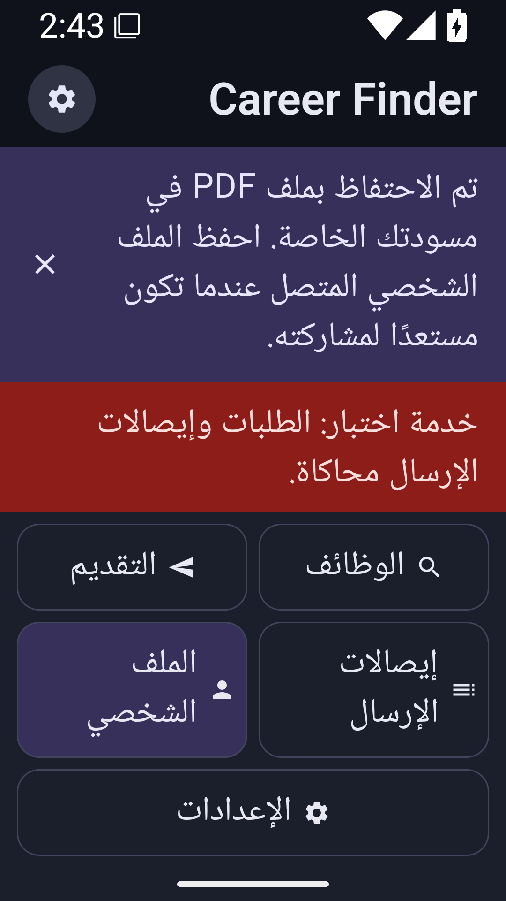
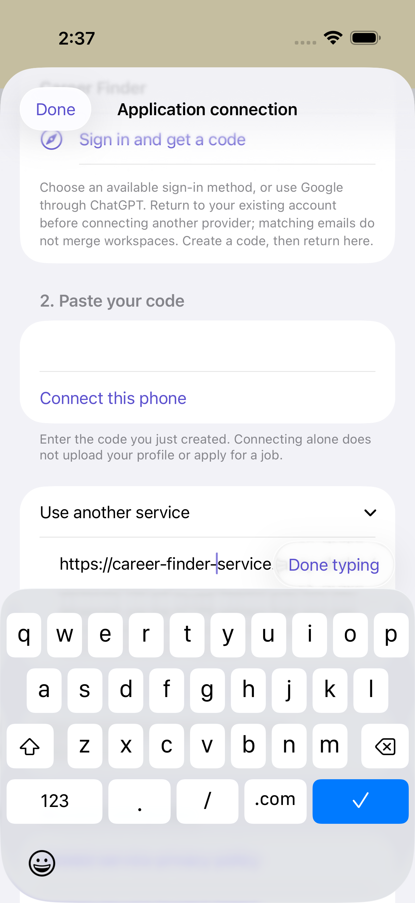

# Phone quality run 32 — native follow-up evidence

## Exact source and terminal result

Run [44101210921](https://github.com/swonyu/ahmad-career/actions/runs/44101210921), Phone quality #32, tested candidate `880e878f6f528d903c42951f10a8b216094c889c` on `continuation/account-acceptance-20261117`. The runner checked out PR merge commit `b29b07f5d79757ddf8026df507ec4d88d40b28e5`; the GitHub comparison returned zero changed files. `checkout-equivalence.json` preserves that check. The candidate tree was `e8d9d4c0017a5a877d40c172ab72254905de3011`.

All five jobs are terminal. Three passed; two failed. The fixes described below were prepared **after** this run and have not yet passed runtime acceptance.

| Gate or native phase | Observed result |
| --- | --- |
| Service and synthetic HTTPS | Passed |
| Hosted HTTPS service and durable storage | Passed |
| iPhone logic and unsigned Release build | Passed |
| Android compile, lint and native acceptance | Failed in the separate native synthetic HTTPS phase |
| Android ordinary phone suite | 104 started, 104 passed, 0 failures, 0 skips |
| Ordinary Android preview TLS rejection | 1 started, 1 passed |
| Android native synthetic HTTPS | 1 started, 0 completed; 900000 ms watchdog timeout |
| iPhone native interface acceptance | 17 executed, 16 passed, 1 failed, 0 unexpected errors; 1473.804 seconds |

`terminal-jobs.json` and `terminal-artifacts.json` are the final GitHub metadata. `android-results.json` and `iphone-ui-results.json` preserve the phase distinction and all 17 iPhone outcomes. The incomplete Android HTTPS test is not counted as an assertion failure, pass, completion or skip. No native failure is hidden by the three successful gates.

## Android: verified large-text viewport defect

The ordinary suite and preview TLS boundary passed. The later HTTPS test successfully paired the synthetic service, created its PDF, edited the profile and accepted the PDF hash. Its final instrumentation marker is `profile-save-scroll:before`; there is no matching after marker or terminal instrumentation result.

The captured Arabic RTL, 180% text screenshot shows the long PDF notice, the synthetic-service warning and three rows of navigation occupying the complete phone viewport. No profile content is visible. This directly establishes a product layout defect. It also supports the diagnosis that the subsequent scroll cannot reach Save because the form has no usable height; the exact internal thread stack is unavailable. The runner's backtrace attempt reported that `debuggerd` requires root, and no escalation was attempted.

The prepared correction keeps accessibility text sizing. It replaces the narrow-screen, large-text navigation grid with one horizontally scrollable row of actual tabs, bounds the message region to 35% of the available content area and makes its text scrollable, and leaves the remaining region for the active screen. Changing language or display geometry resets only the tab-row scroll state; the selected destination and account state remain outside that reset. The synthetic-service warning remains visible ahead of other messages.

Tests reveal an actual tab through its horizontal scroll ancestor before their original touch action. They still require the tab to exist, support real scrolling where appropriate and be displayed. The HTTPS test adds a minimum 120 dp profile-viewport assertion and a screenshot before the original Save scroll and all subsequent consent, retry and receipt assertions. Arabic, RTL, 180% text, test selections and timeouts are retained.

This is a selective reuse of the publishing owner's layout and test-access correction read at [`842472684b194e993355f632902ccc81366c164c`](https://github.com/swonyu/ahmad-career/commit/842472684b194e993355f632902ccc81366c164c), on `continuation/publishing-native-fixes-20261117-01a49`. Only the relevant `PhoneNavigation`, bounded message/content layout, navigation test helper and related reachability pattern were carried into the isolated candidate. It is not a merge of the publishing branch and makes no signing or store change. The independent reviewer checked this local patch; they did not independently fetch that publisher commit object. The source receipt records the exact provenance and file hashes.

## iPhone: verified selection-interaction failure

The prior Arabic persisted-profile/language and mixed-Arabic saved-search failures now pass. The only remaining failure is `testProfileReadinessAndSimpleConnectionSetup`, at its replacement helper's requirement for a reachable Select All edit action.

The native screenshot and hierarchy show a focused `connection.address` URL field, a caret in the middle of the original value, and no edit menu. A whole-URL selection is **not** visible. The correction therefore does not infer selection from an absent Select All command.

The prepared helper retains the working native Select All route. If that action is unavailable, only a nonsecure native text/search field whose existing value contains no newline can use the standard paragraph-selection gesture: three taps with one touch. Apple's [iOS 26 editing guide](https://support.apple.com/en-am/guide/iphone/iph1a9cae52c/26/ios/26) documents the gesture, and the [XCTest API](https://developer.apple.com/documentation/xcuiautomation/xcuielement/tap(withnumberoftaps:numberoftouches:)) exposes the tap count and touch count. The helper then deletes the selection and requires the same exact-empty predicate to pass **before** typing the replacement. The original exact final-value equality, keyboard readiness and full keyboard dismissal predicates remain unchanged.

The menu-unavailable screenshot and hierarchy capture remain. A failed whole-field clearing check now captures its own screenshot and hierarchy. Multiline and secure-field behavior do not take the new alternative. All 17 test names and 141 assertion calls remain; the menu-specific mechanical precondition is changed to permit the documented interaction, while the actual empty and final-value proofs remain identical. The next exact-source iOS 26 run must establish whether that concrete URL-field interaction succeeds.

## Review, integrity and pending verification

`source-followup.json` records the before/after source hashes and both patch hashes. `native-repairs-peer-review.json` records the independent source review, screenshot observations, preservation of behavioral checks and the remaining runtime qualification. The review found one extra blank line at the new Kotlin helper's end; that was removed and the final patches passed `git diff --check` for the changed source.

All four downloaded artifact archives matched GitHub's exact size and SHA-256 digest. `artifact-verification.json` preserves those comparisons. The raw logs and selected failure images are kept here without text normalization. `iphone-failure-attachments.json` links the selected image and original recording to their export manifest and hashes; the full 204 MB iPhone archive and recording remain in the retrieved artifact set, rather than being duplicated in Git. GitHub's current artifact retention expires on 24 November 2026, as recorded in the metadata.

The next candidate must rerun all five required gates. In particular, it must complete the Android synthetic HTTPS sequence beyond Save and pass all 17 iPhone tests. These isolated CI repairs do not prove real provider consent/callback completion, disposable real-account recovery/isolation, physical-device assistive-technology acceptance, signing, store submission or release. Those remain separate owner-coordinated gates. No shared Mac native build, signing operation, real application submission, paid service or public hosted deployment occurred in this lane.

The development branch, public hosted version and publishing branches remain distinct from this CI candidate. The original work budget is unchanged; this evidence packet does not create a new clock.
