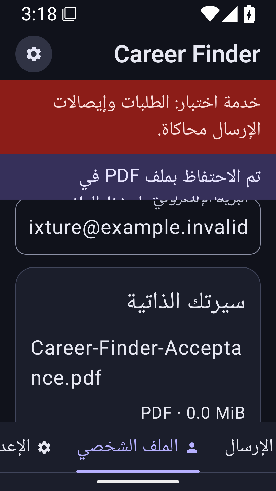
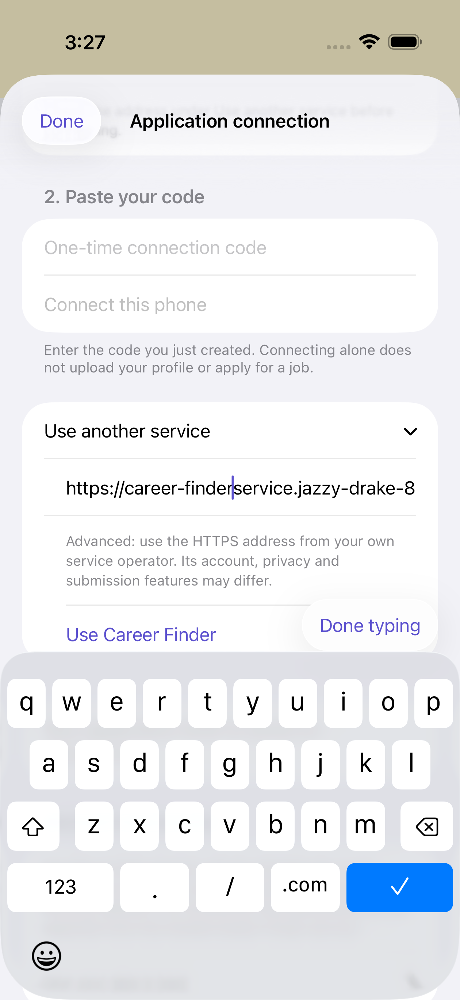

# Phone quality run 33 — verified Android recovery and remaining iPhone edit failure

## Exact source and terminal result

[Phone quality run 44111164968](https://github.com/swonyu/ahmad-career/actions/runs/44111164968), run number 33, tested candidate `fa151e219ad4e8d9f0d3337eec10a60ed5223d47`. The actual PR merge checkout was `6198d44f05cca0c47d5a30042ff23a134cd4fa90`. **Both Git Data commit objects point to tree `3a0333e1c210a89cdb21dfd11b765e24ee70254b`**, and the candidate-to-merge comparison returned zero changed files. See `git-tree-equivalence.json` and `checkout-equivalence.json`. This temporary CI merge is not a merged PR or a release.

The run is terminal with **four passed gates and one failed gate**. It is not a five-gate pass. The follow-up Clear control described below was implemented after this run and still requires its own native build and runtime acceptance.

| Gate or phase | Verified outcome |
| --- | --- |
| Service and synthetic HTTPS | Passed |
| Hosted HTTPS service and durable storage | Passed |
| iPhone logic and unsigned Release build | Passed |
| Android compile, lint and native acceptance | Passed |
| Android ordinary phone suite | 104 started, 104 passed, 0 failures or skips; 139.159 seconds |
| Ordinary Android preview TLS rejection | 1 started, 1 passed; 0.544 seconds |
| Android native synthetic HTTPS | 1 started, 1 passed; 20.288 seconds |
| iPhone native interface acceptance | 17 executed, 16 passed, 1 failed, 0 unexpected errors; 1275.926 seconds |

`terminal-jobs.json`, `terminal-workflow-runs.json`, `android-results.json` and `iphone-ui-results.json` preserve the complete conclusions and test details. Raw job and instrumentation logs are retained without whitespace normalization. No test skip, reduced text size or relaxed value assertion explains these results.

## Android viewport repair verified

In run 32, the Arabic 180% text fixture reached `profile-save-scroll:before` with no profile viewport left beneath its messages and three navigation rows. The prepared navigation/message layout correction now passes the complete Android gate on the exact source above.

The new run retains Arabic app locale, forced RTL, dark appearance, 180% text and the 360 dp phone configuration. The added displayed-profile-height assertion of at least 120 dp passes. Its screenshot shows usable profile content beneath the bounded, scrollable messages and a single horizontally scrollable row of tabs. The 120 dp claim comes from the actual passing assertion, not a visual measurement.

The HTTPS phase log continues through profile Save, application review replacement, approval, recovery with approval still unchecked, cooldown, receipts and uncertain-outcome review. Every recorded before/after pair matches, followed by `test-body:completed`, `activity-rule:finished` and a successful terminal instrumentation result. The original consent, PDF, retry and receipt assertions remain in place. The verification file records zero real-employer requests and no production-account use.

An independent reviewer inspected the actual screenshot, parsed all three phase totals, checked the phase sequence and matched the reviewed source hashes. Their scope and limitations are recorded in `android-runtime-peer-review.json`. The screenshot SHA-256 is `c0bd4dccb7a6e8439a03e91f6a27ffddf2fc214caacd0ffe5c66f86afedc164d` and matches the runner's screenshot manifest.

## iPhone failure: one deletion at a caret

The sole failing method remains `testProfileReadinessAndSimpleConnectionSetup`. The log proves that the missing-menu path issued three taps with one touch and then one Delete. The exact-empty assertion failed at helper line 154 before the requested replacement URL was typed.

The post-action screenshot still shows `https://career-finderservice.jazzy-drake-8…`, with the separating hyphen missing at the caret. Whole-field selection did not occur in this recorded interaction. The unsent code is cleared and Connect is disabled, consistent with the existing address-change invalidation. The other 16 methods, including the Arabic persisted-profile and mixed-Arabic saved-search cases, pass.

The earlier missing-menu image is also retained as `iphone-menu-unavailable.png`. `iphone-failure-attachments.json` binds both images and the case's original recording to the exported manifest and archive hashes. A supported general gesture was not sufficient evidence that this particular field had been cleared; the unchanged exact-empty guard correctly caught the failure.

## Prepared follow-up: a real Clear service address control

The isolated follow-up adds a normal production Clear control to the trailing end of the existing Advanced service-address row. Apple's [Text fields guidance](https://developer.apple.com/design/human-interface-guidelines/text-fields) recommends this affordance for erasing input on iOS. The button appears only for nonempty input, has a plain button style to avoid converting the Form row into its action, has a minimum 44 pt target, and is disabled while the model is busy. It clears the local address and returns focus to that field. The existing address-change handler continues to invalidate the unsent code and clear the old error.

Its accessible label is **Clear service address / مسح عنوان الخدمة**. The canonical `localization/native-copy.json` receives one new entry, and the generator updates both Apple string tables plus the corresponding Android resource tables and ID map. This creates an eight-file patch; the extra generated Android changes preserve the catalog contract and do not add an Android UI behavior. There are now 1762 strings per language; the 144 bounded templates are unchanged.

The service-address test explicitly activates the real Clear control. It fully dismisses the floating keyboard toolbar, reveals the complete button target, checks that the actual button is enabled and hittable, and taps it. The same exact-empty predicate must pass before replacement. The helper then refocuses the field, creates a fresh keyboard-readiness expectation and retains the exact final-value predicate. Other fields retain their working Select All path; the unsuccessful paragraph-selection fallback is removed. The final keyboard dismissal now uses the existing complete dismissal guard.

All 17 method names remain. Static assertion calls increase from 141 to 144. The existing localization generator check and all eight generator contract tests pass, and `git diff --check` passes. No Swift compiler was available in the cloud environment and no shared Mac native build was run. **The new control's native build, UI runtime and physical assistive-technology acceptance remain pending.**

`iphone-clear-control-followup.json` gives all eight before/after source hashes and patch hash `4d1d2d900e4b2f4a512a19f13039abf4e59d224f3a3d5de8b6e1a9a9ee97b4c1`. `iphone-clear-control-peer-review.json` is the independent source review, with no blocking static finding and an explicit runtime qualification. The prepared patch must be tested in the next exact combined source; it is not covered by this run's four passing gates.

## Transfer, coordination and artifact integrity

The candidate was pushed ordinarily from `880e878f6f528d903c42951f10a8b216094c889c` at `2026-11-17T15:09:51.030827Z`, after verifying the complete 949090-byte bundle and its SHA-256. Immediately before and after the push, the protected development head remained `949ce0ad327beab79fa7033423b462ebc7bd98be` and the publishing-copy head remained `fd9c5399f2b7001b234b3b86bf72e2b36b5114c1`.

The owned Mac relay remained an object-only repository at HEAD `303ee73e0e6389593f6cb08eba285405d60f19cb`, with its index absent and the same NUL-delimited status fingerprint. The initial fingerprint discrepancy was resolved as a line-delimited versus NUL-delimited status representation; no path conflict was found. The absent shared build lock was not treated as a build reservation. See `relay-preflight.json` and `push-receipt.json`.

The specifically authorized [draft PR #1](https://github.com/swonyu/ahmad-career/pull/1) body was updated from the prepared file and verified exactly, with draft state preserved. The supplementary scope handoff was [posted once](https://github.com/swonyu/ahmad-career/pull/1#issuecomment-6952079627) and its body verified. These receipts preserve the state at their timestamps; posting does not establish that Dot or the publishing owner read them. The relay was then released.

All four artifact downloads completed, matched GitHub's exact byte count and SHA-256, passed archive path/symlink checks and were extracted. `artifact-verification.json` records those results. The full 215 MB iPhone archive and recording remain in the retrieved artifact set, with selected images and complete logs preserved here. GitHub's recorded artifact retention expires on 24 November 2026.

This lane performed no shared native build, signing, store upload, real employer submission, paid-service activation or public hosted deployment. Hosted, development and release versions remain distinct. Real provider consent/callbacks, production-account recovery, physical devices, screen readers and publishing integration are separate acceptance gates. The original continuation budget is unchanged.
